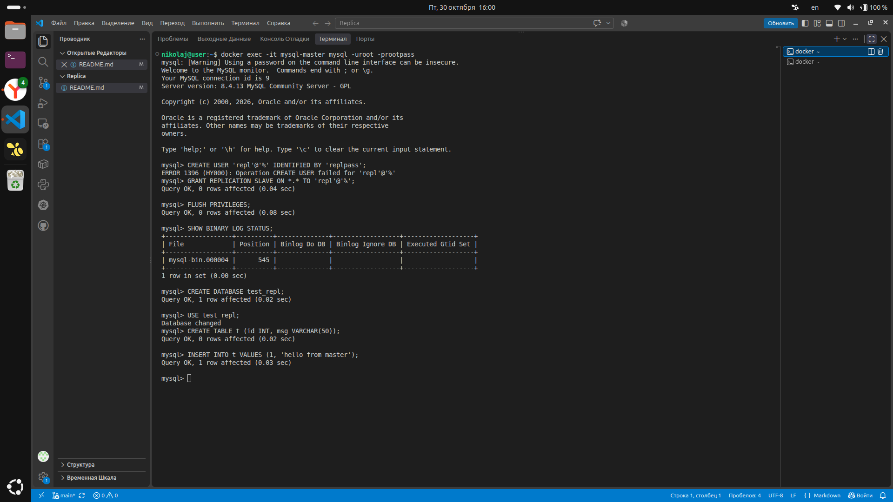
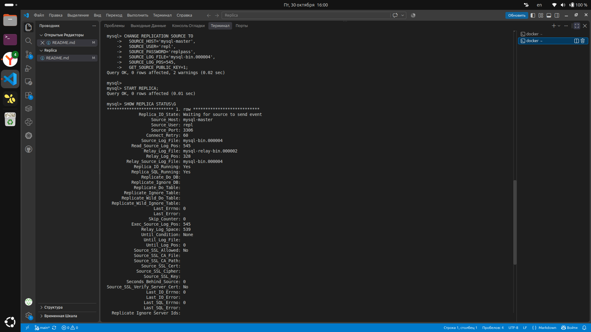
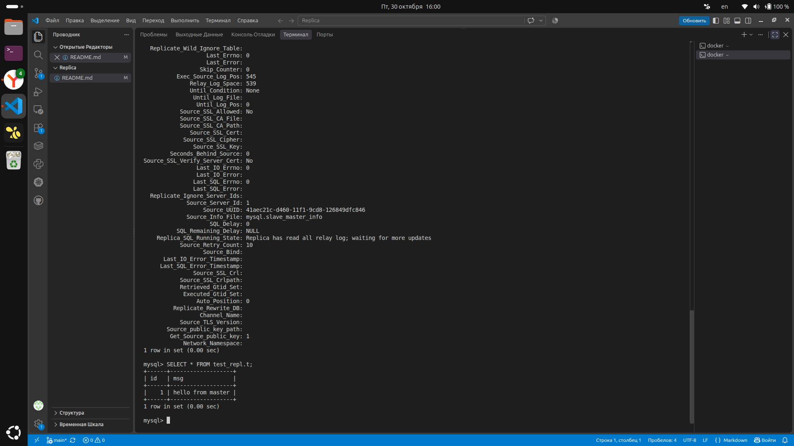

# Отчёт по домашнему заданию: Репликация MySQL
# Выполнил: Галицин Николай 

## Задание 1. Различия master-slave и master-master

**Master-Slave:**
- Запись только на Master, Slave — read-only.
- Поток данных односторонний: Master → Slave.
- Проще, конфликтов нет.
- Минус: Master — единая точка отказа для записи.

**Master-Master:**
- Запись на оба узла.
- Поток данных двунаправленный.
- Плюс: выше доступность записи.
- Минус: риск конфликтов при одновременном изменении одних и тех же строк, сложнее в поддержке.

**Итог:** Master-Slave — «один пишет, многие читают». Master-Master — «оба пишут, оба читают», но с риском конфликтов.

---

## Задание 2. Конфигурация Master-Slave репликации

### Что было выбрано для выполнения

Для выполнения работы выбраны **два Docker-контейнера MySQL 8.4** на одной машине, объединённые в пользовательскую сеть `mysql-repl-net`. Это позволило избежать проблем с системными каталогами, AppArmor и правами доступа, с которыми пришлось столкнуться при попытке настроить второй экземпляр MySQL напрямую на хосте.

**Master:** контейнер `mysql-master`, порт хоста `3307`, `server-id=1`, включён `log-bin`.
**Slave:** контейнер `mysql-slave`, порт хоста `3308`, `server-id=2`, `relay-log`, `read-only=1`.

### Ход работы

**1. Создание сети и запуск контейнеров:**

```bash
docker network create mysql-repl-net
```

```bash
docker run -d \
  --name mysql-master \
  --network mysql-repl-net \
  -p 3307:3306 \
  -e MYSQL_ROOT_PASSWORD=rootpass \
  -v mysql-master-data:/var/lib/mysql \
  mysql:8.4 \
  --server-id=1 --log-bin=mysql-bin --binlog-format=ROW

docker run -d \
  --name mysql-slave \
  --network mysql-repl-net \
  -p 3308:3306 \
  -e MYSQL_ROOT_PASSWORD=rootpass \
  -v mysql-slave-data:/var/lib/mysql \
  mysql:8.4 \
  --server-id=2 --relay-log=mysql-relay-bin --read-only=1
```

**2. На Master создан пользователь репликации и получены координаты:**

```sql
CREATE USER 'repl'@'%' IDENTIFIED BY 'replpass';
GRANT REPLICATION SLAVE ON *.* TO 'repl'@'%';
FLUSH PRIVILEGES;
SHOW BINARY LOG STATUS;
```

**3. На Slave настроено подключение к Master:**

```sql
CHANGE REPLICATION SOURCE TO
  SOURCE_HOST='mysql-master',
  SOURCE_USER='repl',
  SOURCE_PASSWORD='replpass',
  SOURCE_LOG_FILE='mysql-bin.000003',
  SOURCE_LOG_POS=858,
  GET_SOURCE_PUBLIC_KEY=1;
START REPLICA;
```

**4. Проверка статуса:**

```sql
SHOW REPLICA STATUS\G
```

Ключевые поля: `Replica_IO_Running: Yes`, `Replica_SQL_Running: Yes`, `Seconds_Behind_Source: 0`.

### Проблемы и пути решения

| Проблема | Причина | Решение |
|---|---|---|
| `Can't create directory ... errno 17 (File exists)` при инициализации второго экземпляра | MySQL 8.4 требует, чтобы каталог данных не существовал или был пуст, но при этом пытается создать его сам | Попытка удалить каталог и создать заново не помогла — перешли на Docker |
| `errno 13 (Permission denied)` при инициализации | AppArmor блокирует доступ MySQL к нестандартным каталогам (`/var/lib/mysql-slave-data`) | Добавление правил в `/etc/apparmor.d/local/usr.sbin.mysqld` — но проще оказалось использовать Docker |
| `Unknown MySQL server host 'mysql-master' (-2)` | Контейнеры были запущены в сети `bridge` по умолчанию, где нет DNS-разрешения имён | Создана пользовательская сеть `mysql-repl-net`, контейнеры перезапущены с `--network mysql-repl-net` |
| `Authentication plugin 'caching_sha2_password' reported error: Authentication requires secure connection` | MySQL 8.4 по умолчанию использует `caching_sha2_password`, который требует TLS или RSA-обмена для аутентификации по незашифрованному соединению | В `CHANGE REPLICATION SOURCE TO` добавлен параметр `GET_SOURCE_PUBLIC_KEY=1` |

### Скриншоты

**Скриншот 1.** Вывод `SHOW BINARY LOG STATUS;` на Master (координаты `File` и `Position`).



**Скриншот 2.** Вывод `SHOW REPLICA STATUS\G` на Slave (`Replica_IO_Running: Yes`, `Replica_SQL_Running: Yes`).



**Скриншот 3.** Результат `SELECT * FROM test_repl.t;` на Slave после вставки на Master.



### Итог

Репликация Master-Slave успешно настроена и проверена: данные, записанные на Master, появляются на Slave. Использование Docker позволило обойти ограничения AppArmor и упростить развёртывание двух экземпляров MySQL на одной машине.